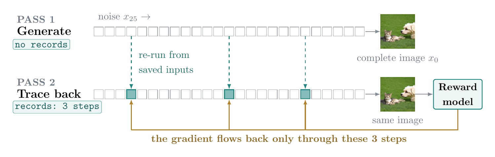
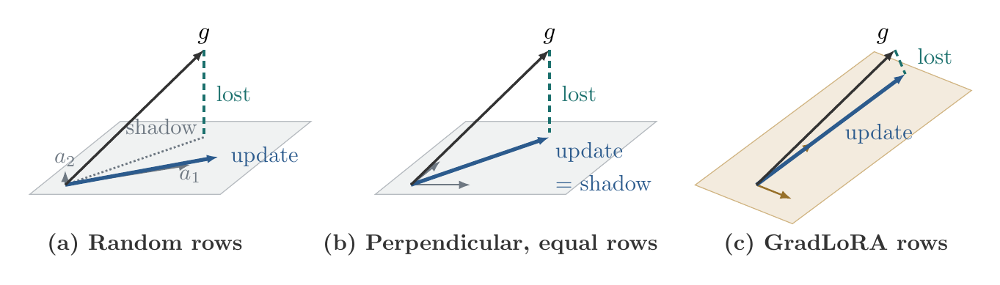

<h1 align="center">FlowBP and GradLoRA</h1>

<p align="center">
  Code for the honours thesis<br>
  <b>Gradient Approximation for Reward Alignment in Generative Flow Models</b><br>
  Boye Niu · Supervisor: Professor Yiming Ying · The University of Sydney, 2026
</p>

<p align="center">
  <a href="#flowbp">FlowBP</a> |
  <a href="#gradlora">GradLoRA</a> |
  <a href="#results">Results</a> |
  <a href="#installation">Installation</a> |
  <a href="#training">Training</a> |
  <a href="https://forge.coreweave.com/wandb/diffusionRL-Curl/thesis">W&amp;B logs</a>
</p>

Reward alignment fine-tunes a pretrained image generator so that its images
receive higher scores from a reward model. For a flow model such as
Stable Diffusion 3.5 Medium (SD3.5-M), the full reward gradient has two costs:
backpropagation runs through all 25 generation steps, and the update touches
all 2.5 billion parameters. This repository implements two approximations of
that full gradient, one for each cost:

- **FlowBP** approximates over the steps: it differentiates only a few
  generation steps.
- **GradLoRA** approximates over the parameters: it trains a rank-eight LoRA
  adapter whose initial space is chosen from reward gradients.

The two can be used separately or together. All experiments fine-tune SD3.5-M
on the HPSv3++ reward.

## FlowBP



FlowBP separates making the image from learning from it.

1. **Pass 1** runs all 25 steps without recording activations and saves each
   step's state `x_i` and velocity `v_i`.
2. **Pass 2** draws `K` active steps uniformly at random (three of 25 in the
   thesis) and reruns only those network calls from their saved inputs with
   recording on. The saved velocities of the other steps rebuild the same
   image.
3. The reward model scores this **complete image** `x_0`, not an estimate of
   it. The gradient flows back only through the direct effects of the active
   steps; the carry-through to later states is dropped.

Because the reward model scores the image the sampler actually generates, the
only remaining error comes from the restricted backward calculation.

In the code, FlowBP is the `flowbp_sparse` trainer
(`flowbp/trainers/sd35/flowbp_sparse.py`). The settings are:

```yaml
trainer:
  name: flowbp_sparse
flowbp_sparse:
  num_active_steps: 3   # K
  late_bias: 0.0        # 0 = uniform draw over all steps
  grad_rescale: 0.0     # raw step sizes, no rescaling
```

The `flowbp_bridge` trainer adds a weighted connection between steps. The
thesis uses it only in Section 6.2.3.

## GradLoRA



Standard LoRA starts its input factor `A` from random rows, so the first
update keeps only the part of the reward gradient that lies in a random
rank-`r` space. GradLoRA picks that space from the reward gradient instead.
For each adapted weight matrix it:

1. **Measures** an approximate reward-gradient matrix at the pretrained
   parameters from four FlowBP calibration batches;
2. **Averages** them into the calibration mean `Ḡ`;
3. **Selects** the leading `r` right singular vectors `V_r` of `Ḡ`;
4. **Initialises** `A₀ = ρ₀ V_rᵀ` and `B₀ = 0`, with
   `ρ₀ = ‖A_rand‖_F / √r`, so `A₀` has the same size as a standard random
   start;
5. **Trains** both factors as in standard LoRA.

Only `A₀` changes. The rank, adapted layers, LoRA scale, number of trainable
parameters, and the unchanged initial model (`B₀ = 0`) are the same as
standard LoRA. Calibration costs four gradient batches, about 1.3% of the 300
training batches, plus one randomised SVD per adapted matrix.

The code is in `flowbp/utils/gradlora_adapter.py`. The settings are:

```yaml
gradlora:
  enabled: true
  target_modules: default   # attention and feed-forward projections
  rank: 8
  alpha: 16                 # LoRA scale s = alpha / rank = 2
  calibration_batches: 4
  calibration_mode: sparse  # calibrate with the FlowBP gradient
  use_second_moment: false  # SVD of the calibration mean
```

## Results

Final evaluation on SD3.5-M after 300 updates, averaged over five rounds of
200 held-out DrawBench prompts. HPSv3++ is the training reward; HPSv2.1,
PickScore, and ImageReward are auxiliary scores. Higher is better.

**Approximation over the steps**, with all parameters trainable
(thesis Table 6.3):

| Method | HPSv3++ | HPSv2.1 | PickScore | ImageReward |
| --- | ---: | ---: | ---: | ---: |
| Pretrained SD3.5-M | 7.06 | 0.275 | 0.862 | 0.77 |
| ReFL | 14.43 | 0.320 | 0.883 | 1.03 |
| DRTune | 14.41 | 0.323 | 0.869 | 0.88 |
| LeapAlign | 13.07 | 0.300 | 0.840 | 0.29 |
| **FlowBP** (K = 3) | 14.99 | 0.325 | 0.883 | 1.13 |

**Approximation over the parameters**, all with FlowBP K = 3 gradients
(thesis Table 6.5):

| Update rule | Trainable | HPSv3++ | HPSv2.1 | PickScore | ImageReward |
| --- | ---: | ---: | ---: | ---: | ---: |
| Dense fine-tuning | 2.5B | 14.99 | 0.325 | 0.883 | 1.13 |
| LoRA, attention only | 6.0M | 13.83 | 0.313 | 0.879 | 0.99 |
| LoRA, all layers | 11.7M | 14.02 | 0.315 | 0.879 | 1.02 |
| **GradLoRA**, all layers | 11.7M | 14.60 | 0.320 | 0.882 | 1.04 |

GradLoRA recovers about 95% of the dense FlowBP reward gain while training
0.47% as many parameters. On held-out samples, the GradLoRA space captures
8.8% of the full-gradient energy, about 90 times as much as random spaces of
the same rank.

## Installation

The experiments used Python 3.10, CUDA 12.4, PyTorch 2.6.0, and one node with
eight GPUs.

```bash
git clone https://github.com/MuL1ian/Thesis_code.git
cd Thesis_code
bash setup.sh
```

`setup.sh` creates a conda environment (set `ENV_ROOT` and `ENV_NAME` to
choose where), installs PyTorch before `flash-attn`, installs the pinned
environment from `requirements.txt`, and installs this repository in editable
mode.

## Data and checkpoints

Model weights, reward checkpoints, and prompt embeddings are not committed.
The configs expect:

| What | Where |
| --- | --- |
| SD3.5-M weights | `checkpoints/SD3.5_medium` |
| HPSv3++ reward | `checkpoints/reward_ckpts/HPSv3-PlusPlus/{config.json,hpsv3++.pth}` |
| Auxiliary reward models | `checkpoints/reward_ckpts` |
| Training prompts | `assets/prompts.txt` (about 104k prompts) |
| Evaluation prompts | `drawbench/test.txt` (200 DrawBench prompts, five rounds) |

Encode the training prompts once with the SD3.5 text encoders:

```bash
bash scripts/preprocess/preprocess_sd35_embeddings.sh
# writes data/sd3_5_rl_embeddings/videos2caption.json
```

`MODEL_PATH`, `PROMPT_FILE`, and `OUTPUT_DIR` override the defaults.

## Training

Every experiment in Chapter 6 has a config in `configs/thesis/`:

```bash
# FlowBP, all parameters trainable
CONFIG=configs/thesis/sd3_5_flowbp_sparse_hpsv3plusplus_k3.yaml \
  bash scripts/finetune/train_sd35.sh

# GradLoRA with FlowBP gradients
CONFIG=configs/thesis/sd3_5_flowbp_sparse_hpsv3plusplus_k3_gradlora_mean_all_r8_lr1e4.yaml \
  bash scripts/finetune/train_sd35.sh
```

Command-line flags after the script override the YAML, for example
`--flowbp_sparse_num_active_steps 5`. The launcher reads `NNODES`,
`NPROC_PER_NODE`, `MASTER_ADDR`, and `MASTER_PORT` for multi-node runs.

[`configs/thesis/README.md`](configs/thesis/README.md) maps each config and
sweep to its thesis table and W&B run. The baselines ReFL, DRTune, and
LeapAlign use the same entry point with `trainer.name` set to `refl`,
`drtune`, or `leapalign`.

## Training logs

Every thesis run, with its learning curves, evaluation scores, and sample
images, is in the W&B project
[diffusionRL-Curl/thesis](https://forge.coreweave.com/wandb/diffusionRL-Curl/thesis).

## Repository layout

```text
configs/thesis/             training configs for the thesis experiments
drawbench/test.txt          evaluation prompts
assets/prompts.txt          training prompts
scripts/preprocess/         prompt-embedding preprocessing
scripts/finetune/           torchrun launcher
flowbp/train_flowbp_sd35.py training entry point
flowbp/config/              YAML and command-line parsing
flowbp/trainers/sd35/       FlowBP, FlowBP-Bridge, and the baselines
flowbp/utils/gradlora_adapter.py   GradLoRA calibration and initialisation
flowbp/utils/rq3_probe.py   held-out capture probe (Section 6.4)
flowbp/rewards/             differentiable training reward (HPSv3++)
flowbp/eval/                online evaluation and auxiliary scores
```

## Acknowledgements

FlowBP was developed in collaborative work with Ruoyu Wang, Xiangxin Zhou,
Yushi Huang, Tongliang Liu, and Chi Zhang. The two-pass implementation builds
on the open-source [LeapAlign](https://github.com/RockeyCoss/LeapAlign_Code)
code.

## Citation

```bibtex
@thesis{niu2026gradient,
  title  = {Gradient Approximation for Reward Alignment in Generative Flow Models},
  author = {Niu, Boye},
  school = {The University of Sydney},
  type   = {Honours thesis},
  year   = {2026}
}

@article{wang2026flowbp,
  title   = {Exploring the Design Space of Reward Backpropagation for Flow Matching},
  author  = {Wang, Ruoyu and Niu, Boye and Zhou, Xiangxin and Huang, Yushi and Liu, Tongliang and Zhang, Chi},
  journal = {arXiv preprint arXiv:2606.11075},
  year    = {2026}
}
```

## License

Apache-2.0. See `LICENSE`.
